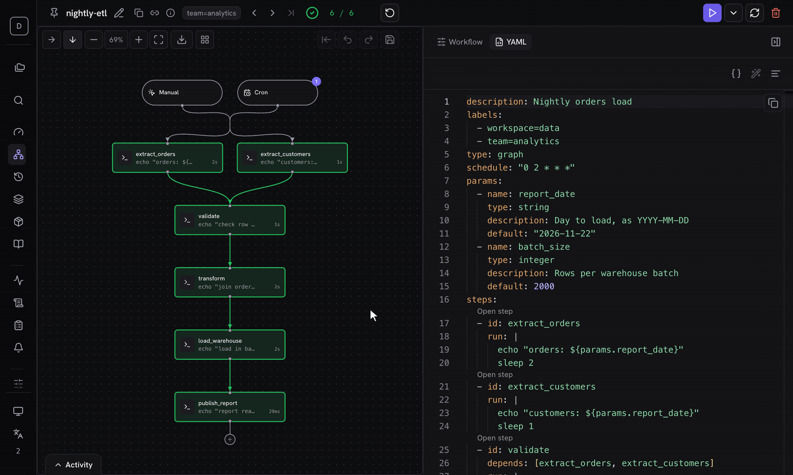

<p align="center">
  <a href="https://dagu.sh">
    
  </a>
</p>

<p align="center">
  <a href="https://dagu-demo-f5e33d0e.dagu.sh">
    
  </a>
</p>

<p align="center">
  <a href="https://dagu.sh">Website</a> ·
  <a href="https://docs.dagu.sh">Docs</a> ·
  <a href="https://dagu-demo-f5e33d0e.dagu.sh">Live demo</a> <code>demouser / demouser</code> ·
  <a href="https://discord.gg/gpahPUjGRk">Discord</a>
</p>

Dagu is a local-first workflow engine for operations and internal automation. Workflows are declarative YAML DAGs that run existing shell commands, Docker containers, Kubernetes Jobs, and remote commands over SSH. It ships as one binary with a built-in Web UI and needs no external database or message broker.

```yaml
schedule: "0 2 * * *"
steps:
  - id: extract
    run: ./extract.sh
    retry_policy:
      limit: 3
      interval_sec: 60
  - id: summarize
    action: duckdb@v1
    with:
      query: SELECT count(*) FROM 'out/*.parquet'
```

### Install

```sh
# macOS / Linux
curl -fsSL https://raw.githubusercontent.com/dagucloud/dagu/main/scripts/installer.sh | bash

# Homebrew
brew install dagu

# Windows (PowerShell)
irm https://raw.githubusercontent.com/dagucloud/dagu/main/scripts/installer.ps1 | iex
```

npm, Scoop, Docker, and Helm are covered in the [installation guide](https://docs.dagu.sh/getting-started/installation/).

### Repositories

| Repository | Contents |
|---|---|
| [dagu](https://github.com/dagucloud/dagu) | Engine, CLI, Web UI, scheduler, coordinator, and workers in one binary |
| [docs](https://github.com/dagucloud/docs) | Source for [docs.dagu.sh](https://docs.dagu.sh) |

### Community

- Questions: [Discord](https://discord.gg/gpahPUjGRk)
- Bugs and feature requests: [Issues](https://github.com/dagucloud/dagu/issues)
- Security reports: [private advisory](https://github.com/dagucloud/dagu/security)
- Updates: [X](https://x.com/dagucockpit)
